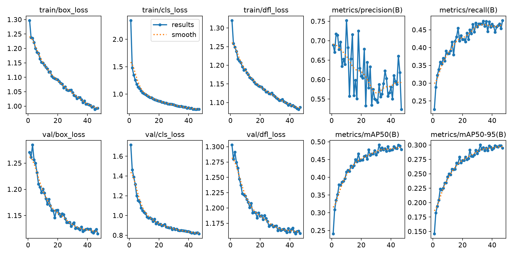

# PPE / Safety-Gear Detection with YOLO11 (SH17)

Detects 17 kinds of people and protective gear (helmet, safety vest, gloves, glasses, face mask, ear-muffs, safety suit and more) in workplace photos. Built with Ultralytics YOLO on the SH17 dataset, evaluated with a **photographer-grouped split** to avoid data leakage, and shipped as a CPU-runnable ONNX model with a Streamlit demo.

> This is my first computer-vision project. The goal was an honest, reproducible pipeline, not a leaderboard number.



## Headline results

| Model                                                  | Input | mAP50     | mAP50-95  |
| ------------------------------------------------------ | ----- | --------- | --------- |
| YOLOv8n baseline (val)                                 | 640   | 0.491     | 0.300     |
| YOLO11n (val)                                          | 640   | 0.519     | 0.314     |
| YOLO11n, validated at higher res                       | 960   | 0.531     | 0.328     |
| **YOLO11n trained at 960 (val)**                       | 960   | **0.558** | **0.348** |
| **Final model on the held-out test split (used once)** | 960   | **0.485** | **0.307** |
| Same model exported to ONNX, CPU (val)                 | 960   | 0.571     | 0.355     |

- The model was chosen using **validation only**. The test split was run **once**, at the end.
- The honest number to quote is the **test result: mAP50 0.485 / mAP50-95 0.307**.
- Test per-class highlights: helmet mAP50 0.679 (mAP50-95 0.429); safety-vest mAP50 0.344 (mAP50-95 0.157), the weak spot.
- The ONNX validation score is slightly higher than the .pt score (+0.013 mAP50, +0.007 mAP50-95). I did not expect a gap. The difference is mostly noise in rare classes (face-guard) plus evaluation-setup differences, and I did not run a controlled check to confirm that. Treat the two as equivalent in practice.

Deployment size and speed:

| Format      | Size         | Speed                                                                                    |
| ----------- | ------------ | ---------------------------------------------------------------------------------------- |
| PyTorch .pt | about 5.5 MB | about 6 ms/image on RTX 4050                                                             |
| ONNX FP32   | about 10 MB  | about 99 ms/image on CPU (plus about 3 ms pre- and 2 ms post-processing), roughly 10 fps |

## Dataset

SH17: 8,099 images, 17 classes, 75,994 boxes, from Pexels (Pexels licence, photographer credits retained). Images were resized to a longest side of 1024 px (aspect ratio kept, never enlarged).

Classes: person, ear, ear-mufs, face, face-guard, face-mask, foot, tool, glasses, gloves, helmet, hands, head, medical-suit, shoes, safety-suit, safety-vest.

Key facts from my EDA (`notebooks/02_eda_and_splits.ipynb`, plots in `docs/`):

- **Heavy imbalance.** `person` appears in about 94% of images. Rare classes: medical-suit (114 images), face-guard (127), safety-suit (141), safety-vest (213), helmet (466).
- **Small objects.** About 30% of boxes are small; `ear` has a median side of about 18 px at 640.
- No exact duplicate images were found.

## The most important finding: photographer leakage

The official SH17 split is random by image. But images from the same photographer look alike (same site, same people, same camera). I found **205 photographers appearing in both train and val, and 91.8% of val images shared a photographer with train**. A random split would therefore overestimate real-world performance.

**Fix:** `StratifiedGroupKFold` (7 folds, seed 42), grouped by photographer and stratified by each image's rarest class. Final split: **5,774 train / 1,143 val / 1,182 test** images, with no photographer shared across splits. Assignments are saved in `docs/split_assignments.csv`.

Limitation: a few rare classes are tiny in held-out data (for example medical-suit has only 6 val and 4 test images), so their metrics are very noisy.

## Approach and experiments

1. Baseline: YOLOv8n at 640, 60 epochs.
2. YOLO11n at 640, same settings (+0.028 mAP50).
3. Same weights validated at 960 (+0.012), suggesting resolution matters for small objects.
4. YOLO11n **trained** at 960 (batch 8, patience 10): best validation result, chosen as final.
5. One-time test evaluation, then ONNX export (static 960x960) and CPU verification.

Fixed 60 epochs for a fair comparison. Training ran locally on an RTX 4050 (6 GB), `workers=2`.

## Failure analysis

Findings are from the test images I inspected by eye plus the confusion matrix. They are not an exhaustive audit.

- **Distant, small helmets and vests are missed**, even at low confidence.
- **Confidence-threshold sensitivity:** some helmets only appear when the threshold is lowered below the default.
- **Class confusions** (validation confusion matrix): hands predicted as gloves (343 boxes), head as ear-mufs (200), shoes as foot (157), head as helmet (95).
- **Close-up scenes work well**, but occasionally produce an extra, duplicated vest prediction.
- **Weakest classes (val mAP50-95):** ear-mufs 0.025, foot 0.072, tool 0.087, medical-suit 0.177, face-guard 0.192. Strongest: person 0.717, face 0.638, head 0.689, hands 0.550, helmet 0.518.

Details and example images: `docs/error_analysis.md`.

## Limitations

- One training run (one seed) per configuration; differences of about 0.01 mAP are within plausible run-to-run noise.
- The 960 run used patience 10 and batch 8; the earlier runs used patience 15 (baseline settings) and batch 16, so the comparison is not perfectly controlled.
- Rare-class metrics are noisy because of tiny val/test counts.
- Safety-vest generalises poorly across photographers (test mAP50 0.344).
- Not a certified safety system. Do not use it to make real safety or compliance decisions.
- The ONNX model is fixed at 960x960 input.

## Run the demo

```bash
git clone https://github.com/kunjagarwal-dev/object-detection.git
cd object-detection
python -m venv .venv
.venv\Scripts\activate        # Windows (use source .venv/bin/activate on Linux/macOS)
pip install -r requirements.txt
streamlit run app/app.py
```

The app loads `models/final_yolo11n_960.onnx` (falls back to the `.pt`) and runs on CPU. Upload an image, adjust the confidence slider, and download the annotated result.

## Reproduce from scratch

```bash
# 1. Download SH17 into data/raw/ and resize
python -m src.resize_images
# 2. Build the photographer-grouped split and YOLO folders
python -m src.splits
# 3. Train (edit src/train.py to pick which run)
python -m src.train
# 4. Evaluate (test split: run once)
python -m src.evaluate
# 5. Export to ONNX and verify
python -m src.export
```

Notebooks: `01_data_verification`, `02_eda_and_splits`, `03_baseline_training`, plus the error-analysis notebook.

## Repository layout

```
configs/data.yaml      dataset config (edit the absolute path for your machine)
src/                   config, data utils, splits, train, evaluate, export, inference
app/app.py             Streamlit demo
notebooks/             verification, EDA, training, error analysis
docs/                  plots, split assignments, results.md, error_analysis.md
models/                final .pt and .onnx
```

## Environment

Python 3.14, Ultralytics 8.4.172, PyTorch 2.14.1 (CUDA), ONNX Runtime 1.31.0.

## Credits and licence

Dataset: SH17 dataset, images from Pexels under the Pexels licence; please credit the photographers listed in the dataset metadata. Model code: Ultralytics (AGPL-3.0), so check its licence terms before any commercial use.
